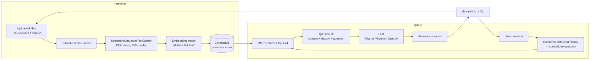
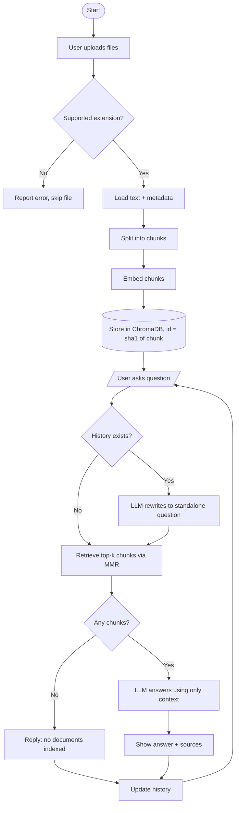
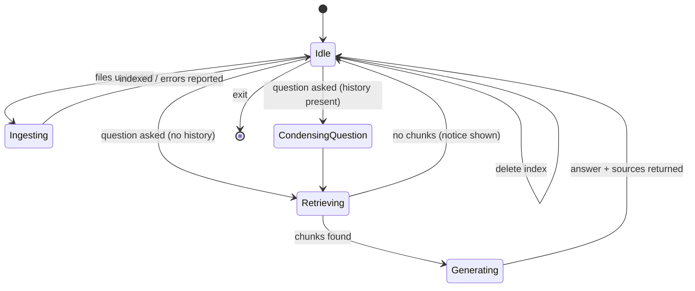

# Technical Documentation — RAG Chatbot (LangChain + ChromaDB)

**Author:** Hassan  |  **Programme:** AI Engineering Internship, Alphatron Technologies (Intermediate Level)
**GitHub:** `<add repository link>`  |  **Drive:** `<add this document's link>`

---

## 1. Project Overview
Large Language Models answer fluently but do not know a user's private documents and can hallucinate.
This project builds a chatbot using **Retrieval-Augmented Generation (RAG)**: relevant passages are
retrieved from the user's own files at question time and given to the LLM as context, so answers are
grounded and traceable to a source.

## 2. Objectives
1. Ingest PDF, DOCX, TXT and Excel files.
2. Embed text chunks and index them in a vector database (ChromaDB).
3. Build a retrieval pipeline that fetches the most relevant chunks.
4. Use prompt engineering to keep answers grounded and reduce hallucination.
5. Support multi-turn conversation (follow-up questions with pronouns).
6. Provide a usable interface (Streamlit + CLI) and full documentation.

## 3. System Architecture

### Component responsibilities
| Module | Responsibility |
|---|---|
| `src/ingestion.py` | Loaders per format, splitting, ID hashing, indexing |
| `src/vector_store.py` | Embedding model and persistent Chroma collection |
| `src/rag_chain.py` | Prompts, LLM factory, `RAGChatbot` (history + retrieval + generation) |
| `app.py` / `cli.py` | User interfaces |

## 4. Flow Diagram

## 5. State Diagram

## 6. Methodology
1. **Loading.** `PyPDFLoader` (per page), `Docx2txtLoader`, `TextLoader` (encoding auto-detect). Excel is read with
   pandas; each sheet becomes one document whose rows are written as `col: value | col: value`, so the embedding
   captures column meaning rather than bare numbers.
2. **Chunking.** `RecursiveCharacterTextSplitter` (1000 chars, 150 overlap) splits on paragraph, line, sentence, word
   boundaries in that order, preserving meaning while keeping chunks within the embedding model's input limit.
3. **Embedding.** `sentence-transformers/all-MiniLM-L6-v2` (384-dim, runs on CPU, free). Vectors are normalised so
   similarity behaves like cosine.
4. **Indexing.** ChromaDB persistent collection. Chunk IDs are SHA-1 hashes of source + text, so re-uploading
   the same file does not create duplicates.
5. **Retrieval.** Maximal Marginal Relevance (MMR): fetch 16 candidates, return 4 that are relevant *and* diverse.
6. **Prompt engineering.**
   - *Condense prompt:* rewrites a follow-up ("what about its price?") into a standalone query before retrieval.
   - *QA prompt:* instructs the model to use only the context, say "I could not find this" if absent, be concise, and cite sources.
   - Temperature 0 for deterministic, factual output.
7. **Conversation memory.** Last 5 question/answer pairs are passed to both prompts.

## 7. Technology Stack
| Layer | Technology |
|---|---|
| Language | Python 3.10+ |
| Orchestration | LangChain (LCEL) |
| Vector DB | ChromaDB |
| Embeddings | sentence-transformers (HuggingFace) |
| LLM | Ollama (Llama 3.1) / Google Gemini / OpenAI — configurable |
| Parsing | pypdf, docx2txt, pandas + openpyxl |
| UI | Streamlit, CLI |
| Version control | Git + GitHub |

## 8. Experimental Results
> Fill this section with **your own measured results** after running the system. Suggested protocol:
> prepare 4 test files (one per format), write 5 questions per file (20 total) with known answers.

| Test file | Format | Chunks created | Questions | Correct | Source cited correctly | Avg. response time |
|---|---|---|---|---|---|---|
| `<file1>` | PDF | | 5 | | | |
| `<file2>` | DOCX | | 5 | | | |
| `<file3>` | TXT | | 5 | | | |
| `<file4>` | XLSX | | 5 | | | |

Also record: (a) an out-of-scope question to confirm the bot refuses to guess, (b) a follow-up question
to confirm conversation memory, (c) screenshots of the UI for each case.

## 9. Challenges and Solutions
| Challenge | Solution |
|---|---|
| Excel is tabular; plain text loses column meaning | Serialise each row as `column: value` pairs |
| Duplicate chunks when same file is uploaded twice | Deterministic SHA-1 chunk IDs (upsert behaviour) |
| Follow-up questions ("what about that?") retrieve poorly | Condense step produces a standalone query |
| Hallucination when context lacks the answer | Strict system prompt + temperature 0 |
| Redundant retrieved chunks | MMR retrieval |
| Cost / API-key dependency | Provider factory with free local option (Ollama) |
| LangChain API changes between versions | Used stable LCEL primitives instead of deprecated prebuilt chains |

## 10. Future Improvements
- OCR for scanned PDFs (e.g. Tesseract) and image support
- Hybrid search (BM25 + vectors) and a cross-encoder re-ranker
- Streaming responses and per-user collections
- Evaluation with RAGAS (faithfulness, answer relevancy)
- Migration to **LangGraph** for agentic RAG (query routing, self-correction) — Advanced-level extension
- Graph RAG for multi-hop questions
- Docker image and CI tests

## 11. References
1. Lewis, P. et al. (2020). *Retrieval-Augmented Generation for Knowledge-Intensive NLP Tasks.* NeurIPS. arXiv:2005.11401
2. LangChain documentation — https://python.langchain.com
3. ChromaDB documentation — https://docs.trychroma.com
4. Reimers, N. & Gurevych, I. (2019). *Sentence-BERT.* arXiv:1908.10084
5. Carbonell, J. & Goldstein, J. (1998). *The Use of MMR, Diversity-Based Reranking.* SIGIR.
6. Ollama — https://ollama.com
7. Streamlit documentation — https://docs.streamlit.io

## 12. GitHub Repository Link(s)
- RAG Chatbot: `<paste link>` (collaborator **AlinaBaber** added)
